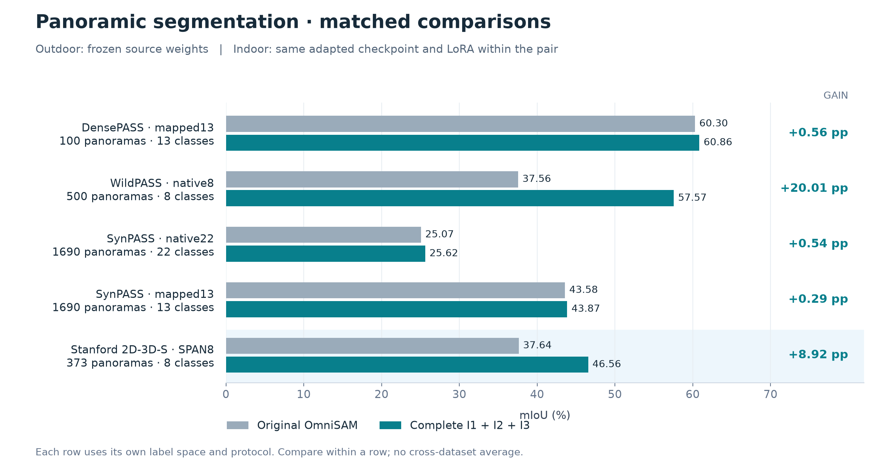
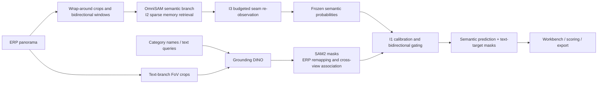
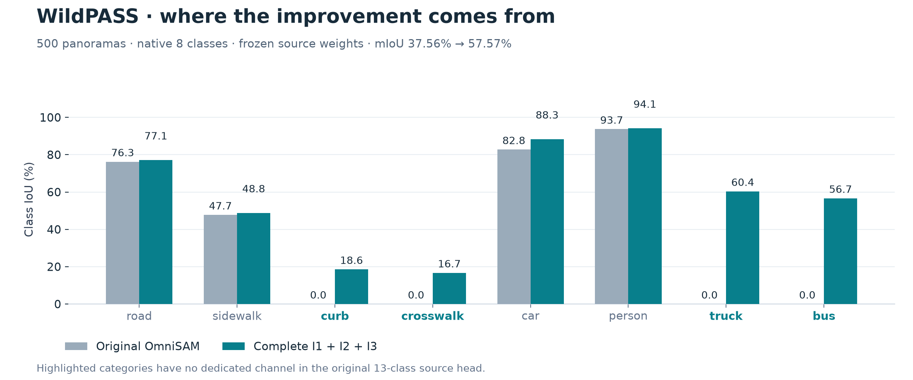
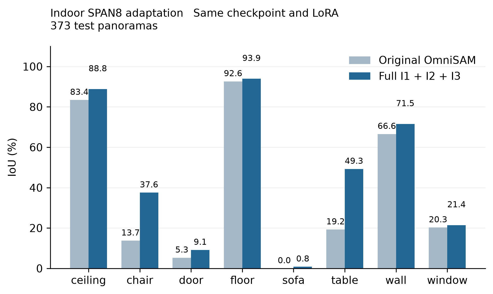
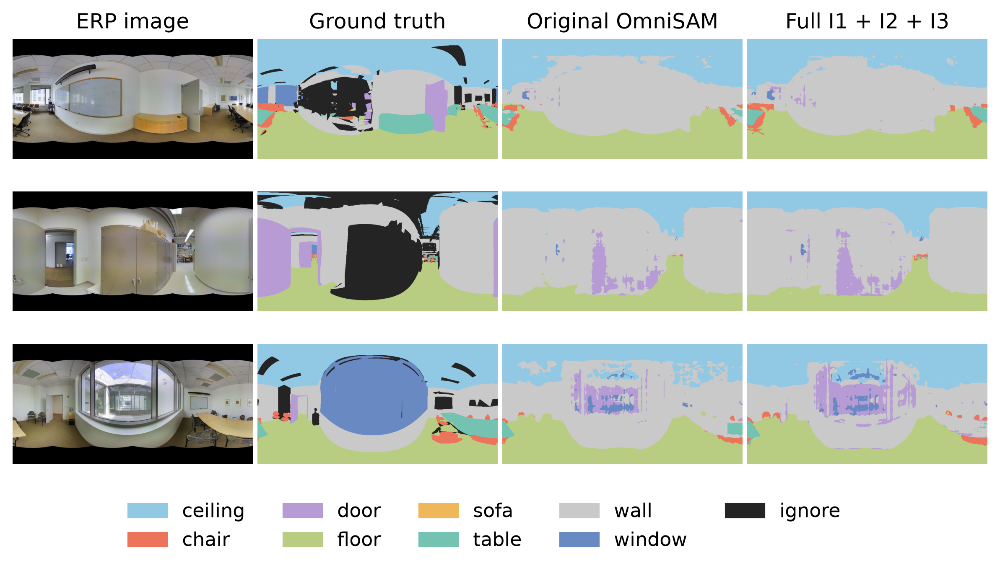
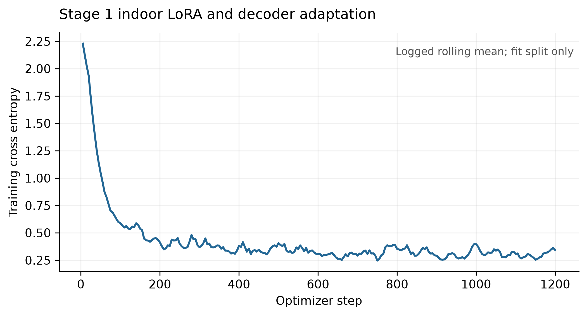
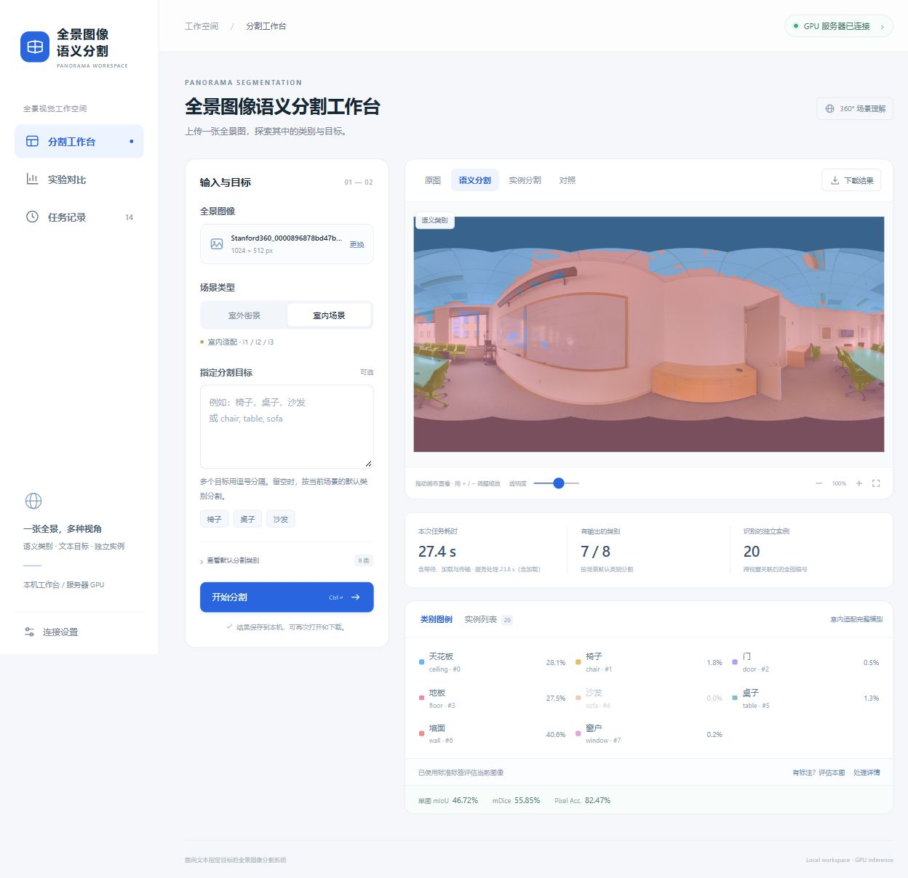

# PIERS · Text–Semantic Cooperation for Panoramic Segmentation

[简体中文](README.md) · **English**

A research and demonstration system built on OmniSAM, organized around **I1 bidirectional text–semantic cooperation, I2 on-demand sparse memory retrieval, and I3 budget-constrained seam re-observation**. Experiments cover outdoor cross-dataset transfer and indoor cross-scene adaptation.

**Main results:** WildPASS native8 mIoU **37.56% → 57.57% (+20.01 percentage points)**; indoor SPAN8 with the same checkpoint and LoRA **37.64% → 46.56% (+8.92 percentage points)**. The repository provides inference code, recomputable result ledgers, adaptation weights, figures, and a local web workbench.

[Three innovations](#innovations) · [Main results](#results) · [Indoor adaptation](#indoor) · [Controls and efficiency](#controls) · [Web demo](#web) · [Quick start](#start) · [Downloads](#artifacts) · [Evidence and limitations](#evidence)



*Each row uses its own dataset and label space. Compare within a row. Outdoor and indoor have different training settings; no cross-dataset mIoU average is reported.*

## 1. Overview and framework

Horizontal wrap-around, projection changes, overlapping windows, and category shifts affect semantic segmentation, text-specified segmentation, and consistency across panoramic views. PIERS adds textual evidence, memory selection, and seam observations to the OmniSAM semantic backbone, and exposes the research pipeline through an interactive workbench.

| Research problem | Approach | Completed evidence |
|---|---|---|
| A fixed head misses novel classes; text candidates can be unreliable | I1: calibrated reliability, bidirectional cooperation, open-vocabulary competition | Native-label comparisons and indoor complete-model comparison |
| Overlapping windows accumulate redundant history | I2: uncertainty ranking with class and boundary protection | Token audits, DensePASS controls, full-system toggle |
| ERP seam regions lack local context | I3: budgeted seam views and conservative fusion | B=0 identity, combination configurations, historical view controls |
| Predictions need interactive inspection and export | Local interface + SSH GPU service | Real jobs, GT scoring, exported masks, archived screenshots |



**Comparison principle:** Each original/full pair shares its task's semantic checkpoint; the indoor pair also shares the LoRA and 8-class decoder. The complete model adds Grounding DINO, SAM2, calibrators, and seam views, with extra computation and resources disclosed separately. Both settings retain the same method family; indoor uses adapted task weights.

<a id="innovations"></a>
## 2. Three innovations

### I1 · Reliability-gated bidirectional text–semantic cooperation

**Objective:** Combine pixel-level semantic predictions with text-conditioned category coverage to reduce misses and unreliable detections.

- **Text → semantics:** Grounding DINO proposes boxes for category queries, and SAM2 generates masks. FoV visibility constraints, ERP remapping, and reliability assessment precede bounded correction of uncertain semantic regions. Open-vocabulary competition supports requested classes without a dedicated source-head channel.
- **Semantics → text:** Frozen semantic probabilities guide, rerank, or filter text candidates within explicit bounds. Guided masks are not fed back as new independent evidence.
- **Reliability calibration:** Outdoor uses source-domain calibrators; indoor 8-class calibrators are fitted on training-area calib104. Inference updates no model weights and excludes GT.

The released text branch is **Grounding DINO + SAM2**. The indoor main experiment does not use CLIP or the historical Stage2 text-alignment checkpoint.

**What the results show:** WildPASS curb, crosswalk, truck, and bus have no dedicated channel in the original 13-class source head. The complete model can predict them through text evidence. The +20.01 pp dataset gain belongs to the complete cooperation/open-vocabulary configuration, not a single substep.



Implementation: [text branch](src/piers_ljj/text/) · [cooperation and open vocabulary](src/piers_ljj/collaboration/) · [complete fusion](scripts/piers/full_model_fusion_v3.py) · [indoor calibration/fusion](scripts/piers/indoor_matched_finish.py)

### I2 · On-demand sparse memory retrieval

**Objective:** Select useful attention inputs from overlapping-window history while retaining uncertainty, rare categories, and boundaries under a budget.

The released configuration uses uncertainty ranking, class-protected quotas, and historical pseudo-label context. Rare-class information comes from training-side statistics. Other retrieval and budget-allocation research implementations are also retained.

| Setting | Dense maximum attention input | I2 maximum attention input | Input reduction |
|---|---:|---:|---:|
| Frozen outdoor | 32,768 tokens | 1,024 tokens | 32× |
| Indoor SPAN8 | 8,192 tokens | 512 tokens | 16× |

These are audited **maximum Memory Attention input lengths**. Dense history remains resident. Geometry and per-frame minimum quotas affect the ratio; the figures do not imply equivalent VRAM or end-to-end speed improvements.

**What the results show:** DensePASS I2-only obtains 60.1447% mIoU versus 60.2961% for original, a budget–accuracy trade-off. The isolated full-system I2 switch changes mIoU by −0.0663 pp, with a 95% interval crossing zero; see Section 5.

Implementation: [memory modules](src/piers_ljj/memory/) · [outdoor engine](scripts/piers/full_model_semantic.py) · [indoor engine](scripts/piers/indoor_matched_semantic.py)

### I3 · Budget-constrained seam re-observation

**Objective:** Supplement incomplete local context around the connected left/right ERP seam with a limited number of additional observations.

- Select extra wrap-around windows using semantic risk, coverage, and geometric constraints.
- The base bidirectional schedule has 18 semantic forwards; B=0/1/2 produces 18/19/20 forwards.
- Fuse conservatively; B=0 exactly recovers the base output.

**What the results show:** On the current DensePASS I2 backbone, B=0 → B=2 changes mIoU from **60.1447% → 60.5018%**, a **+0.3571 pp** difference. Historical standalone controls tied adaptive and uniform selection, so superiority over equal-budget uniform selection is not established.

Implementation: [seam policies](src/piers_ljj/seam/) · [released semantic engine](scripts/piers/full_model_semantic.py) · [indoor seam module](scripts/piers/indoor_seam_i3.py)

<a id="results"></a>
## 3. Main outdoor and indoor results

Metrics come from archived integer confusion matrices. **pp means percentage points; 95% CIs are paired image-bootstrap intervals for full-minus-original mIoU.** The two SynPASS settings use the same 1,690 images with different label spaces and inference configurations.

| Dataset / label space | Images | Original mIoU | Complete mIoU | Gain / pp | Gain 95% CI / pp |
|---|---:|---:|---:|---:|---:|
| DensePASS · standard mapped13 | 100 | 60.2961% | **60.8555%** | +0.5594 | [-0.1762, +1.3930] |
| WildPASS · native8 | 500 | 37.5572% | **57.5670%** | +20.0098 | [+16.3866, +23.2586] |
| SynPASS · native22 | 1,690 | 25.0723% | **25.6163%** | +0.5440 | [+0.3760, +0.7305] |
| SynPASS · mapped13 | 1,690 | 43.5811% | **43.8665%** | +0.2854 | [+0.1598, +0.4208] |
| Stanford 2D-3D-S · SPAN8 | 373 | 37.6424% | **46.5591%** | +8.9167 | [+8.3126, +9.4728] |

**Evaluation settings:** Outdoor transfers frozen source weights. Indoor studies supervised cross-scene adaptation with target-scene training and calibration. DensePASS100 is development validation, and its gain interval crosses zero. WildPASS/SynPASS diagnostics informed v3 repairs, so those results are development-time transfer evidence.

<details>
<summary>Expand mAcc, PixelAcc, FWIoU, and mDice (%)</summary>

| Setting | Method | mAcc | PixelAcc | FWIoU | mDice |
|---|---|---:|---:|---:|---:|
| DensePASS13 | Original | 71.59 | 88.86 | 81.05 | 72.76 |
| DensePASS13 | Complete | 72.79 | 88.82 | 81.10 | 73.43 |
| WildPASS8 | Original | 43.56 | 79.91 | 65.31 | 42.31 |
| WildPASS8 | Complete | 70.28 | 81.60 | 69.07 | 68.86 |
| SynPASS22 | Original | 33.82 | 83.03 | 75.38 | 32.37 |
| SynPASS22 | Complete | 34.89 | 80.87 | 73.61 | 33.93 |
| SynPASS13 | Original | 57.22 | 84.98 | 78.63 | 55.91 |
| SynPASS13 | Complete | 57.80 | 84.77 | 78.30 | 56.46 |
| Indoor SPAN8 | Original | 42.98 | 83.17 | 71.98 | 45.90 |
| Indoor SPAN8 | Complete | 52.04 | 86.06 | 76.58 | 56.08 |

mAcc is macro-averaged class recall; PixelAcc is accuracy over valid pixels; FWIoU weights IoU by GT frequency; mDice is macro-averaged class Dice. Dataset metrics use aggregate confusion matrices. Higher mIoU does not imply every metric improves: SynPASS PixelAcc, for example, decreases.

</details>

Sources: [outdoor main table](results/paper20261109/complete_table.json) · [indoor main table](results/indoor_matched20261112/indoor_results.json) · [figure data/source SHA256](docs/assets/readme/figure_data.json)

<a id="indoor"></a>
## 4. Indoor adaptation with the same checkpoint and LoRA

The **Stanford 2D-3D-S SPAN8 preprocessing setup** contains 1,413 panoramas at 1024×512: fit832, calib104, val104, and 373 heldout images from area5. The ordered classes are ceiling, chair, door, floor, sofa, table, wall, and window; 255 is ignored.

| Item | Recorded setting |
|---|---|
| Shared adapted weights | Stage1 `indoor_lora_last.pth` |
| Trainable components | Rank4 SAM2 image-encoder LoRA + 8-class SegFormer decoder |
| Stage1 training | fit832; cross-entropy; ignore_index=255; fixed 1,200 steps |
| Measured training loss | 2.2287 → 0.3426; joint LoRA/decoder training |
| Original inference | Same adapted weights; dense memory; 18 semantic forwards |
| Complete inference | Same adapted weights; I2+I3; 20 semantic forwards; I1 cooperation |
| I1 calibration | Training-area calib104; an additional complete-method calibrator |
| Main result | mIoU 37.6424% → 46.5591%, +8.9167 pp |
| Verification | Equal weight fingerprints; 155,096,619 valid GT pixels per arm; zero out-of-label predictions |

Sharing controls the semantic checkpoint, LoRA, and decoder; additional calibration parameters and supervision are disclosed. The checkpoint follows fixed-step training and is not claimed optimal. Existing evidence does not isolate the training contributions of LoRA and decoder.



Table **19.25% → 49.26% IoU** and chair **13.73% → 37.55% IoU** show the largest gains; wall and ceiling also improve. Door, window, and sofa remain weak, particularly sofa at 0.85% IoU.



*Fixed heldout indices 0,124,248 were chosen independently of prediction scores. Columns are RGB, GT, original OmniSAM, and complete model.*

<details>
<summary>View measured training loss and all per-class numbers</summary>



| Class | Original IoU / % | Complete IoU / % | Difference / pp |
|---|---:|---:|---:|
| ceiling | 83.43 | 88.79 | +5.37 |
| chair | 13.73 | 37.55 | +23.82 |
| door | 5.29 | 9.13 | +3.84 |
| floor | 92.63 | 93.93 | +1.31 |
| sofa | 0.00 | 0.85 | +0.85 |
| table | 19.25 | 49.26 | +30.02 |
| wall | 66.55 | 71.52 | +4.96 |
| window | 20.26 | 21.44 | +1.17 |

</details>

Protocol/evidence: [configuration](configs/piers/INDOOR_Matched_Fold1.yaml) · [completion checks](results/indoor_matched20261112/FINAL_VERIFICATION.json) · [split/provenance](results/indoor_matched20261112/provenance_check.json) · [indoor reproduction](REPRODUCE_INDOOR.md)

<a id="controls"></a>
## 5. Configuration controls and efficiency

### Completed combinations

| Configuration | DensePASS100 mIoU / % | Indoor373 mIoU / % |
|---|---:|---:|
| Original OmniSAM | 60.2961 | 37.6424 |
| I2-only, B=0 | 60.1447 | — |
| I2 + I3, B=2 | 60.5018 | 42.0019 |
| Complete I1 + I2 + I3 | 60.8555 | 46.5591 |

Indoors, I2+I3 improves over original by **+4.3595 pp**, and adding I1 adds **+4.5572 pp**. These are measured combination differences, not independent indoor attributions for I2 and I3. “—” denotes an unmeasured main-table configuration.

A separate **full-system I2 toggle** on DensePASS obtains 60.9218% without I2 and 60.8555% with I2: −0.0663 pp, 95% CI [−0.5544, +0.3502]. Three fixed images give small-sample mean system time 13.457 → 13.382 seconds, about 0.56% lower, without established VRAM savings.

Sources: [combination accuracy](results/paper20261109/memory_component_accuracy.json) · [full-system I2 toggle](results/paper20261109/full_I2_toggle.json) · [historical I3 controls](docs/piers/INNOV3_成果文档_接缝按需补看.md)

### Recorded complete-system cost

These serial means use **3 fixed images × 2 measured repeats per image** for each setting on RTX6000D. Initial weight loading is excluded; genuine text inference, IPC, and output writing are included.

| Outdoor setting | Original · s/image | Complete · s/image |
|---|---:|---:|
| DensePASS13 | 4.603 | 13.009 |
| WildPASS8 | 4.205 | 16.094 |
| SynPASS22 | 4.358 | 19.472 |
| SynPASS13 | 4.069 | 12.513 |

Recorded whole-device peak usage is approximately 6,457 MiB for original and 9,522 MiB for complete. Additional computation buys accuracy and category coverage; **a whole-system speed or VRAM advantage over original is not established**. Indoor timings sum selected compute stages and cannot be directly compared to this table. Web time additionally includes loading and transfer.

Sources: [DensePASS efficiency](results/paper20261109/densepass_efficiency.json) · [other outdoor efficiency](results/paper20261109/native_efficiency.json) · [efficiency handoff](docs/piers/CURSOR_EFFICIENCY_HANDOFF_20261111.md)

<a id="web"></a>
## 6. Web workbench and real inference

The workbench combines a **local FastAPI interface, an SSH tunnel, and a GPU inference service**. The local machine does not need GPU PyTorch; the server must have the models and weights.



*This is a real job in the Chinese-language interface. Its accuracy is a single-image score, separate from the 373-image aggregate.*

- **Scenes/queries:** Outdoor and indoor; blank text uses defaults, or request categories and supported Chinese aliases.
- **Inspection:** RGB, semantic, instance, sliding comparison, opacity, zoom/pan, and class/instance highlighting.
- **Scoring/export:** User-supplied GT enables image metrics. GT is scored locally, never sent to the model. Export class IDs, 16-bit instance IDs, overlays, JSON audits, and ZIP bundles.
- **Task management:** History, stage progress, GPU exclusion, idle unloading, and manual release.
- **Real acceptance:** Three fixed indoor web predictions match formal predictions pixel-for-pixel; nine result screenshots and one experiment-dashboard screenshot are archived.

Indoor SPAN8 defaults/subsets use the adapted complete model. Requests containing other indoor classes use a separately labelled generic text route. Associated instance counts are model estimates; instance AP has not been benchmarked.

See [web deployment](apps/panorama_web/README.md) · [acceptance record](docs/piers/INDOOR_WEB_RELEASE_20261112.md) · [pixel-equivalence checks](results/indoor_matched20261112/web/verification.json).

<a id="start"></a>
## 7. Quick start

### Verify archived results on CPU

```bash
git clone https://github.com/21Liujj/piers.git
cd piers
python -m pip install numpy pillow
python scripts/paper/reproduce.py verify-ledgers
python scripts/piers/verify_indoor_results.py
```

The outdoor command reconstructs four settings. Indoor verifies five aggregate metrics, per-class IoU, source/calibrator fingerprints for 373 images and three configurations. These commands read ledgers; they start no training or new inference.

### GPU inference environment

The recorded environment is Linux x86_64, Python 3.12, PyTorch 2.8.0+cu128, transformers 4.57.6, and RTX6000D; see [requirements](requirements-paper-20261109.txt). Other platforms need an appropriate PyTorch/CUDA stack.

```bash
python -m pip install -r requirements-paper-20261109.txt
python -m pip install -e . --no-deps
python scripts/paper/reproduce.py fetch-assets
```

Use the [outdoor guide](REPRODUCE.md) for datasets, manifests, and paired inference. Use the [indoor guide](REPRODUCE_INDOOR.md) for Stage1 weights, protocol, and calibrators. Indoor retains original server-path requirements; arrange directories first. Two SAM2 backends use separate processes to avoid namespace conflicts.

### Local Windows workbench

```powershell
python -m venv .venv-web
.\.venv-web\Scripts\python.exe -m pip install -r apps/panorama_web/requirements.txt
.\.venv-web\Scripts\python.exe apps/panorama_web/app.py --port 8010
```

Open [http://127.0.0.1:8010](http://127.0.0.1:8010) and configure the GPU server. Passwords remain in process memory; do not commit passwords, tokens, or personal connection settings. Full prerequisites are in the [workbench README](apps/panorama_web/README.md).

<a id="artifacts"></a>
## 8. Repository and downloads

```text
apps/panorama_web/                Local interface, SSH transport, GPU service
src/piers_ljj/                    Geometry, text, cooperation, memory, seams
scripts/paper/                   Outdoor reproduction, checks, README figures
scripts/piers/                   Indoor training, matched inference, calibration, scoring
experiments/paper20261109/        Frozen outdoor runtime
configs/piers/                   Dataset protocols, experiment matrix, task settings
results/paper20261109/            Outdoor tables, integer ledgers, efficiency evidence
results/indoor_matched20261112/   Indoor tables, splits, calibrators, figures, web checks
assets/                          Weight indexes and small calibrators
docs/                           Method records, acceptance notes, README figures
tests/                          Protocol, geometry, fusion, and other tests
```

| Resource | Contents |
|---|---|
| [Indoor/web v0.4](https://github.com/21Liujj/piers/releases/tag/v0.4-indoor-20261112) | 186 MB shared weights, per-image evidence, web examples, screenshots |
| [Frozen outdoor v0.3](https://github.com/21Liujj/piers/releases/tag/v0.3-paper-20261109) | Outdoor inference weights and reproduction resources |
| [Indoor asset index](assets/indoor20261112/release_assets.json) | Sizes, download URLs, SHA256 values |
| [Outdoor weight index](assets/paper20261109/weights.json) | Required weights and checksums |
| [Chinese experiment/results draft](docs/piers/experiments/INDOOR-MATCHED-DINO-20261112/RESULTS_AND_THESIS_DRAFT.txt) | Indoor methods, analysis, scope, and reproduction |

Code and compact evidence are in Git; large weights and prediction bundles are Release assets. Obtain original datasets from their sources. The web bundle includes only three fixed demonstration examples.

<a id="evidence"></a>
## 9. Reproducibility, scope, and acknowledgments

**Archived evidence:** Exact input manifests/hashes, integer per-image confusion matrices, checkpoint/LoRA fingerprints, calibrators, training logs, original experimental source, and environments. [Publication checks](results/indoor_matched20261112/publication_validation.json) include 18 web CPU contracts, 4 indoor protocol tests, and fresh-checkout verification. New README charts read archived JSON directly; rebuild them with `python scripts/paper/readme_figures.py` after installing plotting dependencies.

Interpretation and reuse should retain these boundaries:

1. **Different training settings:** Outdoor frozen transfer and indoor supervised adaptation answer distinct questions. Semantic weights are shared within each pair; outdoor/indoor weights need not be byte-identical.
2. **Limited test independence:** DensePASS was used for development; outdoor target diagnostics informed repairs. Indoor has one fold/seed, unverified fit/calib room isolation, and earlier heldout smoke inspection. Image bootstrap does not remove same-room view correlation.
3. **Bounded module evidence:** Combination gains do not replace independent ablations; registered configurations are not all completed measurements. Historical CLIP, six-arm, and different-budget runs retain their own protocols and must not be mixed into the main table.
4. **Remaining gaps:** Door/window/sofa accuracy is limited; LoRA is not proven optimal. Whole-system acceleration, VRAM savings, and final Jetson performance remain unestablished.
5. **Demo/evaluation scopes differ:** Image scores, estimated instances, and interactive time do not replace full-dataset semantic metrics, instance AP, or isolated end-to-end benchmarks.

This project builds on OmniSAM in [effective_omnisam](third_party/effective_omnisam/), uses [Grounded-SAM2-related code](third_party/grounded_sam2/), Grounding DINO, and SAM2, and acknowledges their authors and the DensePASS, WildPASS, SynPASS, and Stanford 2D-3D-S dataset authors. Consult respective sources/licenses for third-party code, models, and data; this repository does not relicense them.
