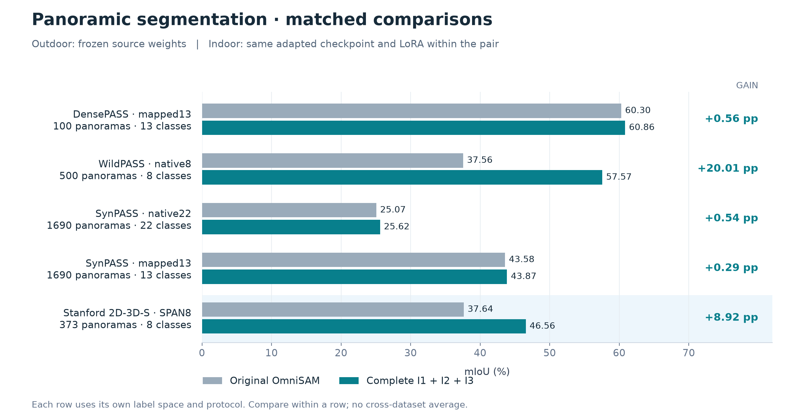
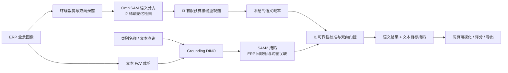
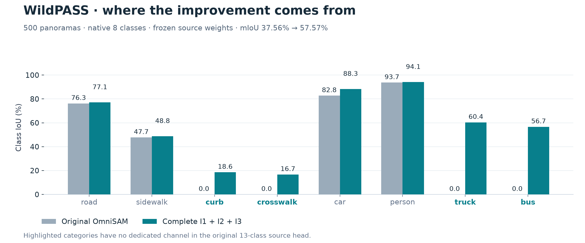
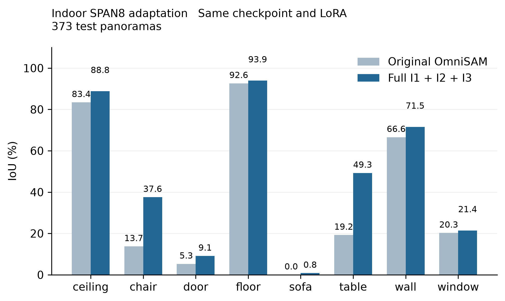
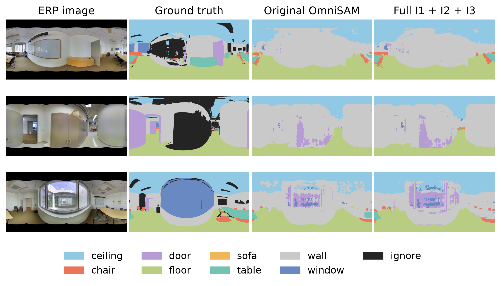
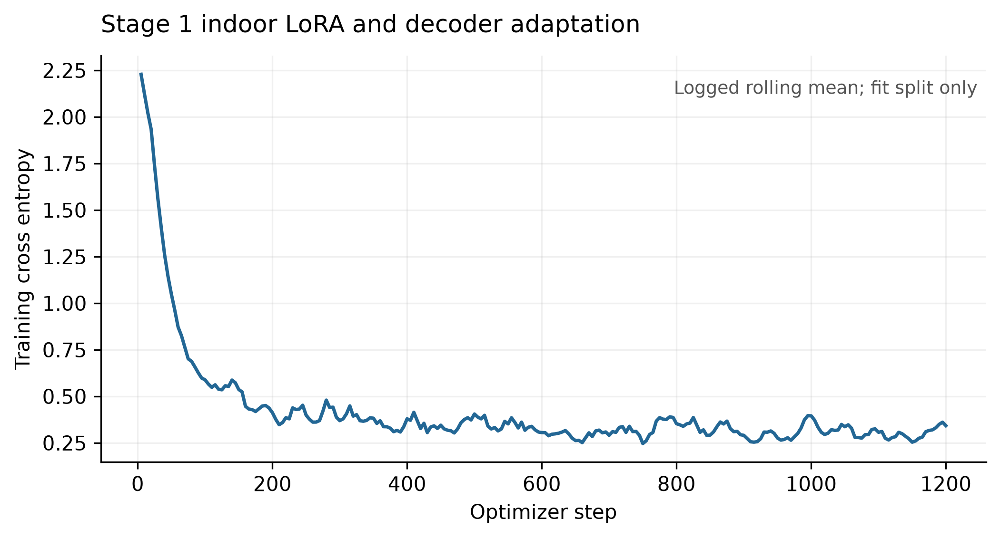
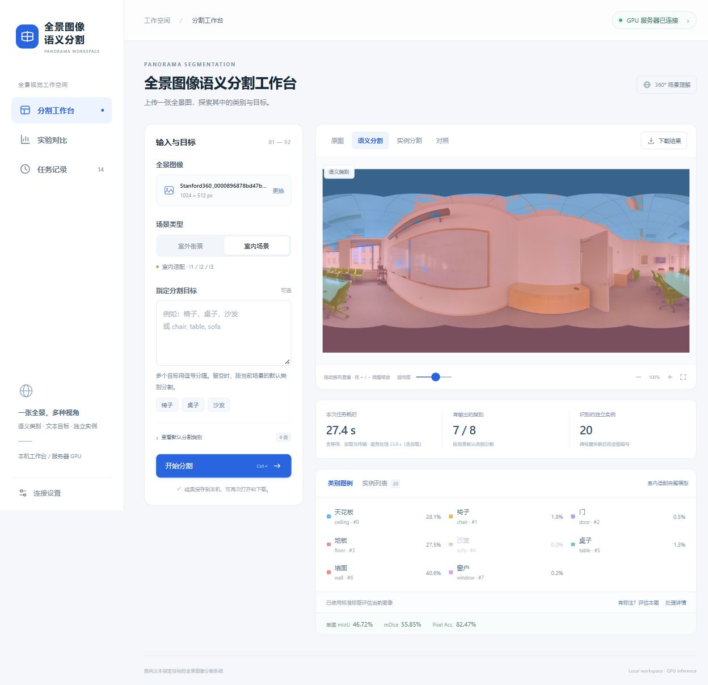

# PIERS · 文本与语义协同的全景图像分割

**简体中文** · [English](README.en.md)

基于 OmniSAM 的全景分割研究与演示系统，围绕 **I1 文本↔语义双向协同、I2 按需稀疏记忆检索、I3 预算约束的接缝重观测** 三项方法设计，研究室外跨数据集迁移与室内跨场景适配。

**主要成果：** WildPASS 原生8类 mIoU **37.56% → 57.57%（+20.01 个百分点）**；室内 SPAN8 在同一 checkpoint、同一 LoRA 下 **37.64% → 46.56%（+8.92 个百分点）**。本仓库提供推理代码、可重算的实验账本、适配权重、图表与本机网页工作台。

[三个创新点](#innovations) · [实验主表](#results) · [室内适配](#indoor) · [配置与效率](#controls) · [网页演示](#web) · [快速开始](#start) · [成果下载](#artifacts) · [证据与局限](#evidence)



*每行采用各自的数据集与标签空间，仅在同一行内比较。室外与室内训练设置不同，不进行跨数据集 mIoU 平均。*

## 1. 项目概览与整体框架

全景图像的水平环绕、投影变化、滑窗重叠与类别迁移，会同时影响语义分割、文本指定目标分割和跨视窗一致性。PIERS 在 OmniSAM 语义底座上加入文本证据、记忆选择和接缝补充观测，并将研究实现接入交互网页。

| 研究问题 | 本项目的处理方式 | 已完成的证据 |
|---|---|---|
| 固定语义头缺少新类别，文本候选也可能误检 | I1：可靠性校准、双向协同、开放词汇竞争 | 原生标签空间对比与室内完整模型对比 |
| 重叠窗口积累大量冗余历史记忆 | I2：不确定性排序、类别与边界保护 | token审计、DensePASS配置对照、整机开关实验 |
| ERP接缝附近的局部上下文不足 | I3：有限预算跨缝观测与受控融合 | B=0恒等性质、组合配置与历史选窗对照 |
| 结果需要交互查看和导出 | 本机界面 + SSH GPU推理服务 | 真实任务、GT评分、掩码导出与截图归档 |



**对照原则：** 每个原始/完整对照共享该任务的语义 checkpoint；室内还共享同一 LoRA 和8类解码器。完整模型额外使用 Grounding DINO、SAM2、校准器与接缝窗口，计算量及附加资源单独披露。室内外沿用相同方法框架，室内使用适配后的任务权重。

<a id="innovations"></a>
## 2. 三个创新点

### I1 · 可靠性门控的文本↔语义双向协同

**目标：** 结合语义模型的像素级判断与文本模型的类别覆盖能力，减少单一路径的漏检和误检。

- **文本→语义：** Grounding DINO 根据类别查询生成框，SAM2 生成掩码。经 FoV 可见区约束、ERP 回映射和可靠性判断后，文本证据对不确定语义区域进行受控修正。开放词汇竞争允许请求原始语义头没有专用通道的类别。
- **语义→文本：** 冻结的语义概率对文本候选进行有界引导、重排或过滤；引导后的掩码不再回流为新的独立证据。
- **可靠性校准：** 室外使用源域校准器；室内在训练区域 calib104 上拟合8类校准器。推理时不更新模型参数，GT不进入推理。

正式文本分支为 **Grounding DINO + SAM2**，室内主实验未使用 CLIP 或历史 Stage2 文本对齐 checkpoint。

**结果解读：** WildPASS 的 curb、crosswalk、truck、bus 在原始13类源域头中没有专用通道，完整模型通过文本路径获得这些类别的输出。整体 +20.01 pp 反映完整协同与开放词汇配置的效果，不能全部归因于某一个子步骤。



实现：[文本分支](src/piers_ljj/text/) · [协同与开放词汇](src/piers_ljj/collaboration/) · [完整融合](scripts/piers/full_model_fusion_v3.py) · [室内校准与融合](scripts/piers/indoor_matched_finish.py)

### I2 · 按需稀疏记忆检索

**目标：** 从重叠滑窗的历史记忆中选择更有用的注意力输入，在预算内保留不确定区域、稀有类与边界信息。

当前配置使用不确定性排序、类别保护配额与历史伪标签上下文，稀有类信息来自训练侧统计。仓库另保留其他检索策略与预算分配研究实现。

| 场景 | dense最大注意力输入 | I2最大注意力输入 | 输入规模缩减 |
|---|---:|---:|---:|
| 室外冻结配置 | 32,768 tokens | 1,024 tokens | 32倍 |
| 室内SPAN8 | 8,192 tokens | 512 tokens | 16倍 |

以上是**最大 Memory Attention 输入长度**的审计结果。dense历史特征仍然驻留；几何与每帧最小保留量影响实际比例，不能据此推导同倍数的显存或整机加速。

**结果解读：** DensePASS 的 I2-only 为60.1447% mIoU，原始模型为60.2961%，属于预算与精度的折中。完整系统中单独开关 I2 的差异为−0.0663 pp，95%区间跨零，详见第5节。

实现：[记忆模块](src/piers_ljj/memory/) · [室外引擎](scripts/piers/full_model_semantic.py) · [室内引擎](scripts/piers/indoor_matched_semantic.py)

### I3 · 预算约束的接缝重观测

**目标：** 针对 ERP 左右接缝连接但局部上下文不足的问题，用有限额外观测补充跨缝信息。

- 根据语义风险、覆盖与几何约束选择有限的跨缝窗口。
- 基础双向滑窗为18次语义前向；B=0/1/2 对应18/19/20次前向。
- 新观测受控融合；B=0时严格退化为基础输出。

**结果解读：** 当前 DensePASS 配置在 I2 底座上，B=0 → B=2 为 **60.1447% → 60.5018%**，提高 **0.3571 pp**。历史独立对照中 adaptive 与 uniform 选窗打平，因此尚未证明自适应选窗优于等预算均匀选窗。

实现：[接缝策略](src/piers_ljj/seam/) · [发布版语义引擎](scripts/piers/full_model_semantic.py) · [室内接缝模块](scripts/piers/indoor_seam_i3.py)

<a id="results"></a>
## 3. 室内外主要实验结果

指标来自已归档的整数混淆矩阵。**pp表示百分点；95% CI为完整减原始的配对图像bootstrap区间。** SynPASS的两个口径使用同一批1,690张图像，但标签空间与推理配置不同，分别报告。

| 数据集 / 标签空间 | 图像数 | 原始 mIoU | 完整 mIoU | 提升 / pp | 提升的95% CI / pp |
|---|---:|---:|---:|---:|---:|
| DensePASS · 标准映射13类 | 100 | 60.2961% | **60.8555%** | +0.5594 | [-0.1762, +1.3930] |
| WildPASS · 原生8类 | 500 | 37.5572% | **57.5670%** | +20.0098 | [+16.3866, +23.2586] |
| SynPASS · 原生22类 | 1,690 | 25.0723% | **25.6163%** | +0.5440 | [+0.3760, +0.7305] |
| SynPASS · 映射13类 | 1,690 | 43.5811% | **43.8665%** | +0.2854 | [+0.1598, +0.4208] |
| Stanford 2D-3D-S · SPAN8 | 373 | 37.6424% | **46.5591%** | +8.9167 | [+8.3126, +9.4728] |

**实验口径：** 室外使用冻结源域权重研究跨数据集迁移；室内使用目标场景训练及校准，研究监督适配后的跨场景表现。DensePASS100是开发验证集，提升区间跨零。WildPASS/SynPASS诊断结果参与过v3修复，需作为开发过程中的迁移证据报告。

<details>
<summary>展开查看 mAcc、PixelAcc、FWIoU 与 mDice（%）</summary>

| 评测口径 | 方法 | mAcc | PixelAcc | FWIoU | mDice |
|---|---|---:|---:|---:|---:|
| DensePASS13 | 原始 | 71.59 | 88.86 | 81.05 | 72.76 |
| DensePASS13 | 完整 | 72.79 | 88.82 | 81.10 | 73.43 |
| WildPASS8 | 原始 | 43.56 | 79.91 | 65.31 | 42.31 |
| WildPASS8 | 完整 | 70.28 | 81.60 | 69.07 | 68.86 |
| SynPASS22 | 原始 | 33.82 | 83.03 | 75.38 | 32.37 |
| SynPASS22 | 完整 | 34.89 | 80.87 | 73.61 | 33.93 |
| SynPASS13 | 原始 | 57.22 | 84.98 | 78.63 | 55.91 |
| SynPASS13 | 完整 | 57.80 | 84.77 | 78.30 | 56.46 |
| 室内SPAN8 | 原始 | 42.98 | 83.17 | 71.98 | 45.90 |
| 室内SPAN8 | 完整 | 52.04 | 86.06 | 76.58 | 56.08 |

mAcc是逐类别召回率的宏平均，PixelAcc是全部有效像素正确率，FWIoU按GT频率加权，mDice是类别Dice的宏平均。整体指标由汇总混淆矩阵计算。mIoU提高不意味着其他指标全部提高，例如SynPASS的PixelAcc存在下降。

</details>

来源：[室外完整主表](results/paper20261109/complete_table.json) · [室内完整主表](results/indoor_matched20261112/indoor_results.json) · [绘图数据与来源SHA256](docs/assets/readme/figure_data.json)

<a id="indoor"></a>
## 4. 室内跨场景适配：同一 checkpoint + 同一 LoRA

使用 **Stanford 2D-3D-S 的 SPAN8 全景预处理设置**，共1,413张1024×512图像：fit832、calib104、val104，area5的373张用于heldout。8类依次为ceiling、chair、door、floor、sofa、table、wall、window，255为忽略标签。

| 项目 | 正式设置 |
|---|---|
| 共享适配权重 | Stage1 `indoor_lora_last.pth` |
| 可训练部分 | SAM2图像编码器rank=4 LoRA + 8类SegFormer解码器 |
| Stage1训练 | fit832，交叉熵，ignore_index=255，固定1,200步 |
| 实测训练loss | 2.2287 → 0.3426；LoRA与解码器联合训练 |
| 原始流程 | 相同适配权重，dense memory，18次语义前向 |
| 完整流程 | 相同适配权重，I2+I3，20次语义前向，加I1协同 |
| I1校准 | 训练区域calib104；完整方法额外使用此校准器 |
| 主结果 | mIoU 37.6424% → 46.5591%，+8.9167 pp |
| 核验 | 权重指纹一致；两侧有效GT像素均155,096,619；越界预测为0 |

共享的是语义checkpoint、LoRA与解码器，额外校准参数与监督用途单独记录。当前权重来自固定步数训练，未宣称达到最佳性能；现有实验也不能分离LoRA和解码器各自的训练贡献。



桌子 **19.25% → 49.26% IoU**、椅子 **13.73% → 37.55% IoU** 是主要收益；墙面和天花板也有改善。门、窗与沙发仍是弱项，尤其沙发仅0.85% IoU。



*固定取heldout清单索引0、124、248，未按预测成绩筛选；从左到右为原图、GT、原始OmniSAM、完整模型。*

<details>
<summary>查看实测训练曲线与完整逐类数值</summary>



| 类别 | 原始IoU / % | 完整IoU / % | 差异 / pp |
|---|---:|---:|---:|
| ceiling | 83.43 | 88.79 | +5.37 |
| chair | 13.73 | 37.55 | +23.82 |
| door | 5.29 | 9.13 | +3.84 |
| floor | 92.63 | 93.93 | +1.31 |
| sofa | 0.00 | 0.85 | +0.85 |
| table | 19.25 | 49.26 | +30.02 |
| wall | 66.55 | 71.52 | +4.96 |
| window | 20.26 | 21.44 | +1.17 |

</details>

协议与证据：[配置](configs/piers/INDOOR_Matched_Fold1.yaml) · [完整性核验](results/indoor_matched20261112/FINAL_VERIFICATION.json) · [划分与来源](results/indoor_matched20261112/provenance_check.json) · [室内复现](REPRODUCE_INDOOR.md)

<a id="controls"></a>
## 5. 模块配置对照与效率

### 已完成的组合配置

| 配置 | DensePASS100 mIoU / % | 室内373 mIoU / % |
|---|---:|---:|
| 原始OmniSAM | 60.2961 | 37.6424 |
| I2-only，B=0 | 60.1447 | — |
| I2 + I3，B=2 | 60.5018 | 42.0019 |
| 完整I1 + I2 + I3 | 60.8555 | 46.5591 |

室内I2+I3核心比原始提高 **+4.3595 pp**，加入I1后再提高 **+4.5572 pp**。这是已测组合之间的差异，不能分别确定室内I2、I3的独立贡献；“—”表示该主表未测配置。

另有DensePASS完整系统的 **I2单独开关控制**：不启用I2为60.9218%，启用后60.8555%；差异−0.0663 pp，95% CI [−0.5544, +0.3502]。三张固定图像的小样本整机均值为13.457 → 13.382秒，约下降0.56%，没有显存节省证据。

来源：[组合精度](results/paper20261109/memory_component_accuracy.json) · [整机I2开关](results/paper20261109/full_I2_toggle.json) · [历史I3对照](docs/piers/INNOV3_成果文档_接缝按需补看.md)

### 记录的整机开销

下表为RTX6000D上每个口径 **3张固定图像 × 每图2次测量**的串行均值，排除首次权重加载，包含真实文本分支、进程通信与结果写出。

| 室外口径 | 原始·秒/图 | 完整·秒/图 |
|---|---:|---:|
| DensePASS13 | 4.603 | 13.009 |
| WildPASS8 | 4.205 | 16.094 |
| SynPASS22 | 4.358 | 19.472 |
| SynPASS13 | 4.069 | 12.513 |

上述口径记录的整设备峰值占用约为原始6,457 MiB、完整9,522 MiB。完整模型以更多计算获得精度与类别覆盖收益，**尚未实现相对原始模型的整机加速或显存优势**。室内记录的是阶段计算耗时之和，不能与本表直接比较；网页耗时还包含加载与传输。

来源：[DensePASS效率](results/paper20261109/densepass_efficiency.json) · [其他室外效率](results/paper20261109/native_efficiency.json) · [效率工作交接](docs/piers/CURSOR_EFFICIENCY_HANDOFF_20261111.md)

<a id="web"></a>
## 6. 网页系统与真实推理展示

网页采用 **本机FastAPI界面 + SSH通道 + GPU推理服务**。本机不需要GPU版PyTorch，服务器须预先准备模型与权重。



*截图来自真实网页任务，图上精度属于当前单张图像，与373张整体指标分别报告。*

- **场景与查询：** 支持街景/室内；文本留空采用默认类别，也可指定类别或已收录的常见中文别名。
- **结果查看：** 原图、语义、实例、滑动对照、透明度、缩放拖动，以及类别/实例突出显示。
- **评分与导出：** 用户提供GT后计算单图指标，GT仅在本机评分，不发送给模型。导出类别ID、16位实例ID、叠加图、JSON审计与ZIP。
- **任务管理：** 历史记录、阶段进度、GPU互斥、空闲卸载与手动释放。
- **真实验收：** 3张固定室内网页预测与正式实验对应预测逐像素一致；归档了9张结果截图和1张实验对比页截图。

室内SPAN8默认类别及其子集使用适配完整模型；包含其他类别的室内请求使用单独标注的通用文本路线。实例数量为关联后的模型估计，尚未测实例AP。

查看：[网页部署](apps/panorama_web/README.md) · [验收记录](docs/piers/INDOOR_WEB_RELEASE_20261112.md) · [像素一致性记录](results/indoor_matched20261112/web/verification.json)

<a id="start"></a>
## 7. 快速开始

### CPU核验已归档结果

```bash
git clone https://github.com/21Liujj/piers.git
cd piers
python -m pip install numpy pillow
python scripts/paper/reproduce.py verify-ledgers
python scripts/piers/verify_indoor_results.py
```

室外命令重算4个口径；室内核验373张、3种配置的五类汇总指标、逐类IoU、源码及校准器指纹。此过程读取账本，不启动训练或新推理。

### GPU推理环境

记录环境为Linux x86_64、Python 3.12、PyTorch 2.8.0+cu128、transformers 4.57.6、RTX6000D，见[版本清单](requirements-paper-20261109.txt)。其他平台需使用相应PyTorch/CUDA环境。

```bash
python -m pip install -r requirements-paper-20261109.txt
python -m pip install -e . --no-deps
python scripts/paper/reproduce.py fetch-assets
```

按[室外指南](REPRODUCE.md)准备数据、生成清单并运行对照；室内按[室内指南](REPRODUCE_INDOOR.md)下载Stage1权重、安装协议与校准器。室内保留原服务器路径要求，需先布置目录。两个SAM2后端使用独立进程以避免命名空间冲突。

### Windows本机网页

```powershell
python -m venv .venv-web
.\.venv-web\Scripts\python.exe -m pip install -r apps/panorama_web/requirements.txt
.\.venv-web\Scripts\python.exe apps/panorama_web/app.py --port 8010
```

打开[http://127.0.0.1:8010](http://127.0.0.1:8010)，在连接设置中配置GPU服务器。密码只保存在进程内存；不要提交密码、令牌与个人连接配置。完整前置条件见[网页README](apps/panorama_web/README.md)。

<a id="artifacts"></a>
## 8. 仓库结构与成果下载

```text
apps/panorama_web/                本机网页、SSH传输与GPU服务
src/piers_ljj/                    几何、文本、协同、记忆与接缝模块
scripts/paper/                   室外复现、核验、README绘图
scripts/piers/                   室内训练、正式推理、校准和评分
experiments/paper20261109/        冻结室外运行时
configs/piers/                   数据协议、实验矩阵与任务配置
results/paper20261109/            室外主表、整数账本与效率证据
results/indoor_matched20261112/   室内主表、划分、校准器、图表与网页核验
assets/                          权重下载索引与小型校准器
docs/                           方法记录、验收说明与README图表
tests/                          协议、几何、融合等测试
```

| 下载入口 | 内容 |
|---|---|
| [室内与网页v0.4](https://github.com/21Liujj/piers/releases/tag/v0.4-indoor-20261112) | 186 MB共享权重、完整逐图记录、网页案例与截图 |
| [室外冻结v0.3](https://github.com/21Liujj/piers/releases/tag/v0.3-paper-20261109) | 室外推理权重与复现资源 |
| [室内附件索引](assets/indoor20261112/release_assets.json) | 文件大小、下载地址与SHA256 |
| [室外权重索引](assets/paper20261109/weights.json) | 所需权重与校验值 |
| [中文实验与论文结果草稿](docs/piers/experiments/INDOOR-MATCHED-DINO-20261112/RESULTS_AND_THESIS_DRAFT.txt) | 室内方法、结果分析、结论范围与复现说明 |

代码和小型证据保存在Git，大权重与完整预测包通过Releases提供。原数据集图像及标签需按原来源获取；网页附件仅含3张固定演示样例。

<a id="evidence"></a>
## 9. 可复现性、结论范围与致谢

**已保存的证据：** 精确输入清单及哈希、逐图整数混淆矩阵、checkpoint/LoRA指纹、校准器、训练日志、原始实验源码及环境记录。[发布核验](results/indoor_matched20261112/publication_validation.json)包含18项网页CPU契约测试、4项室内协议测试及新Git checkout验证。README新图直接读取归档JSON，可在安装绘图依赖后运行 `python scripts/paper/readme_figures.py` 重新生成。

解读与使用时需保留以下范围：

1. **训练设置不同：** 室外冻结迁移与室内监督适配分别研究。共享语义权重发生在各原始/完整对照内部，室内外权重不要求字节相同。
2. **测试独立性有限：** DensePASS用于开发，室外目标诊断参与修复。室内仅一折、一组训练种子，fit/calib真实房间隔离未核验，heldout曾用于smoke诊断；图像bootstrap不能消除同房间视角相关性。
3. **模块证据有边界：** 组合收益不代替独立消融，已注册配置不等于全部完成测量。历史CLIP、六arm及不同预算记录保留各自协议，不与主表混用。
4. **性能仍有弱项：** 门、窗、沙发精度有限，LoRA未证明最优；整机加速、显存节省和Jetson最终部署效果尚未建立。
5. **演示与评测分开：** 单图指标、实例估计与交互耗时不能替代全量语义指标、实例AP或隔离的端到端效率测试。

本项目基于[effective_omnisam](third_party/effective_omnisam/)的OmniSAM实现，使用[Grounded-SAM2相关代码](third_party/grounded_sam2/)、Grounding DINO与SAM2，感谢上述工作及DensePASS、WildPASS、SynPASS、Stanford 2D-3D-S数据集作者。第三方代码、模型与数据的使用范围请查看对应来源和许可证；本仓库不重新授权第三方资产。
